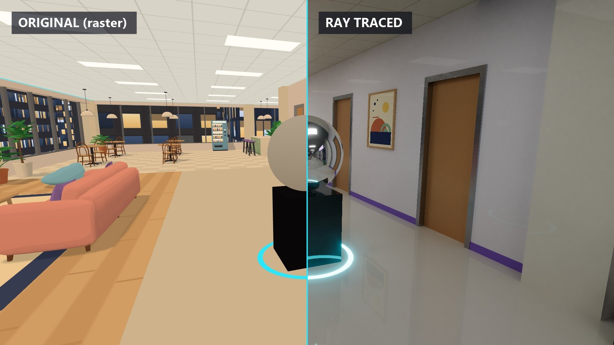
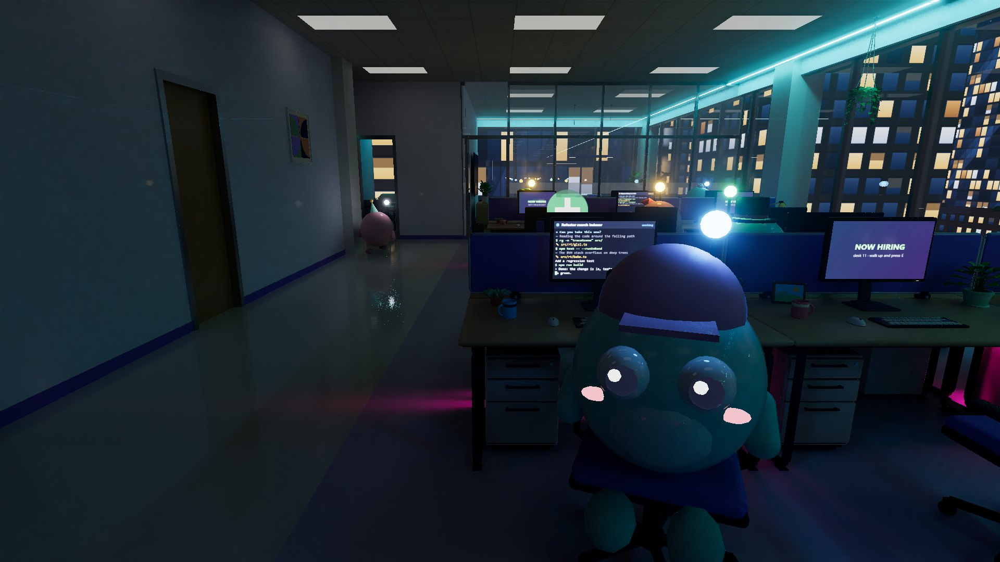
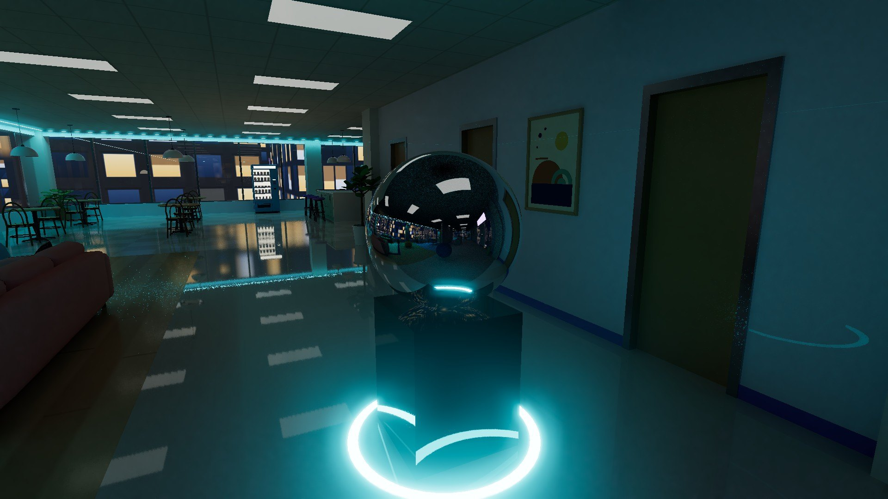
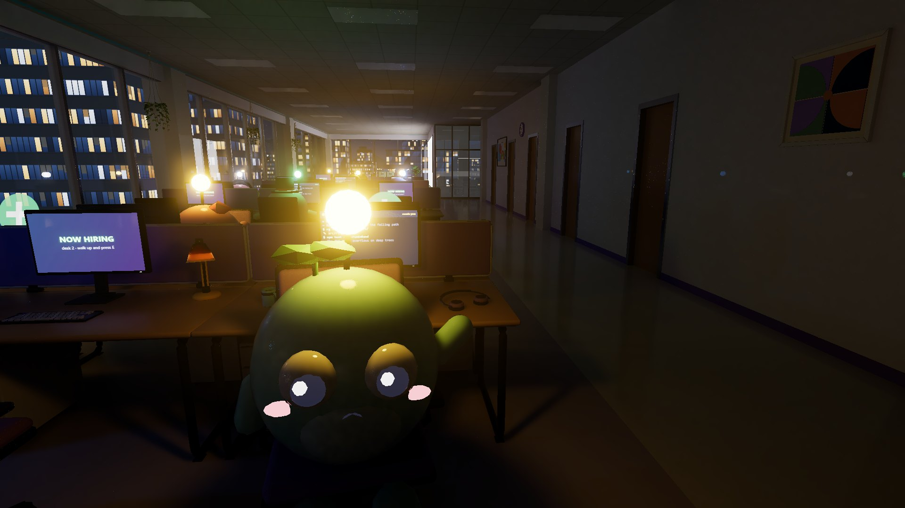
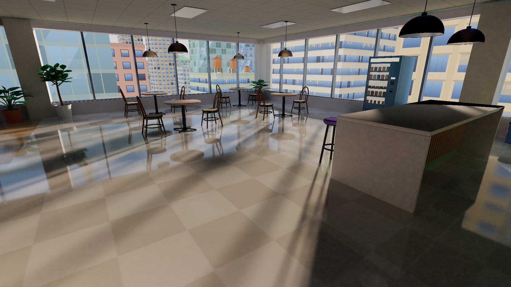

# Agent Office 🫧

A cozy 3D office where your [T3 Code](https://t3.codes) threads and [Claude Code](https://claude.com/claude-code)
sessions are little round workers ("Bloops").
Walk around in first person, peek at their screens, chat with them, hold meetings, hire and lay off agents,
and run an issue board, all backed by your live T3 Code threads and Claude Code sessions.

## Run it

Make sure the T3 Code app is open (or use Claude Code floors, below), then:

```sh
npm install
npm run dev        # http://127.0.0.1:5199
```

`npm start` builds and serves an optimized version instead.

### As a Mac app

```sh
npm run app:install   # builds "Agent Office.app" and puts it in /Applications
```

(`npm run app` only builds it, into `release/`.) It's a normal Mac app: its own window with no browser
around it, a Dock icon, full screen, and ⌘Q. Closing the window keeps it running in the Dock so floor
managers still hear when their agents finish. Click the Dock icon to bring the window back.

- It runs the office server itself on port 5199. If `npm run dev` is already running there, the app shows
  that office instead of starting a second one.
- It picks up your login shell's environment (`PATH`, `GITLAB_TOKEN`...), same as the terminal.
- Links to T3 threads or GitLab open in your browser. **Help → Open in Browser** opens the office there too.
- The code is in `electron/`, and `scripts/build-app.ts` builds the app. Re-run `npm run app:install` after
  you change the office. The icon is a Bloop rendered by `dev/icon.html` (`npm run app:icon`).
- It's signed ad hoc, so it runs on this Mac. Sharing it with other Macs needs a Developer ID and notarization.

### Where the office keeps its data

Desks, the issue board, managers and settings live in `~/Library/Application Support/Agent Office/office.json`,
shared by the app, `npm run dev` and `npm start`. Set `AGENT_OFFICE_DATA` to use another file.

## Real-time ray tracing ⚡ (optional)

Flip the **⚡** switch in the top bar (or press **G**) to render the office with a hybrid real-time ray tracer
(`src/rt/`). The **▾** next to it opens the options: lighting mood, which passes run, debug views and live stats. It's off by default and remembered per browser; while it's off the office looks and runs exactly as
before, and nothing is built for it until you first turn it on. It wants a decent GPU.

The office and the Bloops are rasterized into a G-buffer, then every pixel traces rays against a BVH of the whole office
([three-mesh-bvh](https://github.com/gkjohnson/three-mesh-bvh), built in a worker) plus analytic spheres for every Bloop:

- **Reflections**: polished marble, tile, wood and resin floors, mirror-steel lift doors, a chrome sculpture in the lobby,
  glossy Bloops, and glass that traces its own mirror reflection. Rays that hit something on screen reuse last frame's
  finished pixel, so reflections have textures, faces and reflections of their own.
- **Ray-traced soft shadows** from every light: ceiling panels, monitors (coloured by what's on screen), lamps, neon,
  the sun and moon through the curtain wall, and each Bloop's status bulb.
- **Status colours are real lights**: blue working, yellow needs input, green done, red error. Their glow spills
  onto desks and neighbours, so you can see who needs you across a dark floor.
- **One bounce of global illumination**, temporal accumulation (with mirror reflections reprojected through their
  virtual image) and an edge-aware à-trous denoiser.
- Synthwave set dressing while it's on: a cyan ceiling cove along the glazing and pink underglow beneath the desk benches.
- Swivel chairs are baked facing their desks; while one turns, rays near it are moved into the frame of a spare chair
  stashed in the BVH, so turned chairs keep exact shadows and reflections without rebuilding anything.







| Key | |
|---|---|
| **G** | Ray tracing on/off (same as the ⚡ switch; compare with the original toon look) |
| **L** | Lighting mood: *Live* (follows the real time of day), *Neon noir*, *Lights out* |
| **X** | Debug views: final, diffuse light, reflections, normals, roughness/metal |
| **N** | Denoiser on/off (see the raw 1-sample rays) |

`?rt=1` / `?rt=0` override the switch for one visit. `?demo=1` fills an office with no agents with demo Bloops whose
status changes every few seconds, handy for trying it out. Runs at ~230 fps at 1280×720 and ~115 fps at 2560×1440 on
an RTX 5090.

## How it maps to T3 Code

| In the office | In T3 Code |
|---|---|
| A floor | A project (the elevator lists them; "Build floor" adds a project) |
| A Bloop at a desk | A thread |
| Antenna and bubble color | Thread state: blue working, yellow needs input, green done (unread), red error, grey idle |
| Their monitor | The thread's latest activity: commands, thinking, edits, messages |
| Talking to them | Sending a message (`t3 thread send`); questions and approvals can be answered inline |
| Hiring at an empty desk | Starting a thread (`t3 thread start`) with your task |
| Laying off | Settling the thread, and stopping it first if it's running (they pack a box and take the elevator out). The thread stays in T3; un-settle it there and they come back. |
| Office Chat (T) | Messaging any thread from anywhere; unread badges for new replies, questions and approvals inline |
| Meeting room | Your message goes to every attendee; their replies show up in the meeting log |
| Your intern (🌱, **I**) | One thread with no desk. It lives in T3's "No project" space and follows you between floors. Every message tells it which floor you're on, so you can ask how something on that project works, or ask anything else |
| Issue board + PM | Tickets stored in the office's data file, or mirrored from a linked GitLab issue board. The PM is a thread that manages the board, and its settings, through the office's HTTP API |
| Floor manager (corner office) | A thread per floor that staffs it: hires agents with briefs, hands out work, checks on everyone, and fires agents who aren't needed, through the office's HTTP API. It doesn't write code |

## Claude Code floors

A floor can also be a folder whose agents are [Claude Code](https://claude.com/claude-code) sessions. In the
elevator (**F**), type the folder's path, pick **Claude Code**, and **Build floor**. T3 Code floors are unchanged,
and both kinds can sit in the same building.

| In the office | In Claude Code |
|---|---|
| A floor | A folder on this machine |
| A Bloop at a desk | A session in that folder: the ones hired in the office, plus sessions from the last 24 hours that you ran elsewhere (the CLI, the desktop app, an IDE) |
| Hiring at an empty desk | Starting a session with your task, run here by the [Claude Agent SDK](https://docs.claude.com/en/docs/agent-sdk/overview) with your own Claude Code settings, `CLAUDE.md` and permission rules. Pick Opus, Sonnet or Haiku, or the default |
| Approvals and questions | Tool permission prompts and `AskUserQuestion` show up as "needs input" with Allow / Allow for this session / Deny, or the question's options |
| Talking to them | Sending a message to the session (it resumes it if it was idle). Sessions still running in another window are read-only until they finish |
| Their monitor | The session's transcript (`~/.claude/projects`): commands, edits, searches, todos, messages |
| Laying off | Stopping the session and hiding it from the office; its transcript stays in Claude Code |
| Floor manager and board PM | Claude Code sessions in the folder, allowed to `curl` the office API without asking |
| Your intern | A T3 Code thread as usual; with no T3 Code projects, a Claude Code session on the floor you're on |

The SDK is an optional dependency that only loads once a Claude Code floor exists, and it uses your Claude Code
login. Settings, all optional:

- `AGENT_OFFICE_CLAUDE_PERMISSION_MODE`: the sessions' permission mode (`default`, `acceptEdits`, `plan`, ...). Default `default`, so tools ask first.
- `AGENT_OFFICE_CLAUDE_RECENT_HOURS`: how far back to pick up sessions run outside the office. Default 24.
- `CLAUDE_CODE_PATH`: a Claude Code executable to run instead of the one bundled with the SDK.
- `CLAUDE_CONFIG_DIR`: where Claude Code keeps its data, if not `~/.claude`.

## Controls

- Click the view to grab the mouse, then **WASD** to walk (**Shift** runs). **Esc** lets go of the mouse.
- **E** or click: use whatever is under the crosshair (talk, hire, board, meeting, elevator buttons).
- **Elevators**: walk up to a lift and the doors open. Step in, aim at a floor on the button panel beside the door and
  press **E**: the doors close, the car moves (the indicator counts the floors) and they open on that floor. The lit
  directory between the lifts lists every floor. **F** still jumps straight to any floor (`src/world/elevator.ts`).
- **V** switches between first person and an over-the-shoulder overview.
- **F** floors · **B** issue board · **R** staff roster · **I** intern · **M** mute · **G** ray tracing.
- **T** opens Office Chat, a messenger with every agent on every floor. It stays open while you walk:
  **Enter** to type (Enter sends and puts you back to walking), **[** / **]** to switch chats.
- The top-right list shows everyone who needs you on any floor. Click a name to walk over.

## Architecture

- `server/t3.ts` talks to the local T3 Code server. It reads the orchestration shell and thread snapshots
  over HTTP with a scoped token minted by `t3 auth session issue`. It sends archive, stop, settle and
  answer commands over T3's WebSocket RPC, and starts and messages threads with the `t3` CLI.
- `server/claude.ts` runs Claude Code floors: sessions hired in the office run in-process through the Claude
  Agent SDK (approvals and questions come back through `canUseTool`), and the rest are read from their
  transcripts with the SDK's `listSessions`.
- `server/bridge.ts` is the office API (`/api/*`) plus a server-sent-events stream. It runs inside Vite in
  dev (`vite.config.ts`), or in `server/http.ts` in production (`server/main.ts` for the browser, `electron/main.ts` for the Mac app). It only accepts requests from this machine.
- `src/world/*` holds the Three.js scene: floor plan (`layout.ts`), office props (`office.ts`), Bloops (`bloop.ts`),
  A* navigation (`nav.ts`), player/camera (`player.ts`) and in-world screens (`screens.ts`).
- `src/ui/*` holds the DOM overlays: agent panel, issue board, modals and toasts.

### The building

- `src/world/floorplan.ts` is the floor plan as data: rooms, walls and doors, furniture, seats and decor. It drives both the 3D build and the 2D drawing. Regenerate the drawing with `node scripts/floorplan-svg.ts`, which writes `docs/floorplan.svg`. Design notes and the review log are in `docs/floorplan.md`.
- `src/world/city.ts` is the downtown outside the windows, with our own tower's façade. Each project floor is a real storey; the first is 12F, about 48 m up. Preview it on its own at `/dev/city-preview.html?view=north&elev=90`.
- `src/world/daynight.ts` runs a day/night cycle on your real local time. It computes the sun's actual position for your time zone's city, or for `?lat=&lon=` if you pass them. After dark the sky fills with stars and a moon in its current phase, windows light up across town, and street lamps, headlights, taillights, tower beacons and the Ferris wheel come on. The office lighting also warms up. To preview a time, add `?time=21:30` to the URL (or `?timescale=600` to fast-forward), or run `dayNight.setTime("6:45")` in the console; `setTime(null)` goes back to live.
- 3D models are scripted in Blender (`assets/blender/*.py`) and exported to `public/models/*.glb`. Rebuild them all with `./assets/blender/build_all.sh`; preview renders go to `assets/previews/`. In-game they're toon-shaded and instanced (`src/world/assets.ts`). A missing model falls back to a simple built-in shape.

### The floor manager

Each floor can have a manager, who works from the corner office in the southeast. To hire one, walk up to the empty desk in that office and press **E**, or open the staff roster (**R**, or the board on the office wall). The manager doesn't write code. They staff the floor for you:

- **Hiring**: they turn your requests into briefs and hire agents for them. New agents walk up from the elevator to a free desk like anyone else.
- **Delegating**: they message agents (who see the message comes from the manager) and read their recent activity.
- **Firing**: they lay off agents who are finished, stuck, or redundant, with a one-line reason. They check with you before firing anyone whose work is unfinished. They can't fire themselves or your intern.
- **Following up**: when an agent the manager hired or messaged finishes or hits an error, the office sends the manager an "[Office update]" message, so they can follow up without polling.

The staff roster lists everyone on the floor with Talk and Let go buttons, has a message box to the manager, and keeps a log of hires and firings (who did it, and why). The same log runs along the bottom of the wall board. The manager's API is in `server/manager.ts`. Agents can read it with `curl -s 'http://127.0.0.1:5199/api/manager/guide?projectId=<id>'`.

### The issue board

Each floor's board has its own settings. Open them with **⚙ Board settings** in the board view, or ask the board manager (PM) to change them:

- **Columns**: their names, colors, and order. Each column can mirror a GitLab list: issues with a given label, GitLab's Open list (open issues not in another column), or Closed issues.
- **Wall board vs. board view**: pick which columns (up to 4) the big board on the office wall shows, and which the board you open with **B** shows. Each can show all tags on cards, none, or only the ones you name.
- **Automation**: which column a ticket moves to when it's assigned, and when its agent finishes.
- **GitLab**: paste a project or board URL (`https://gitlab.com/group/project/-/boards/12`, self-hosted works too) and an access token with `api` scope, or start the office with `GITLAB_TOKEN` set. The office syncs every 30 seconds. Moving, adding and editing tickets in the office updates GitLab, and deleting one closes the GitLab issue. **Use the GitLab board's lists as columns** copies the board's lists. Agent assignments stay in the office.

The token is saved in the office's data file on this machine and never sent to the page. Agents can read the full board API with `curl -s 'http://127.0.0.1:5199/api/board/guide?projectId=<id>'`.

### Adding things

New areas are plain functions in `src/world/office.ts` (add meshes + `colliders`). Make them interactive by
adding an entry to `interactables()` in `src/main.ts`. Agents can drive the office through the bridge API too
(see the PM brief in `server/bridge.ts` for the endpoints).
